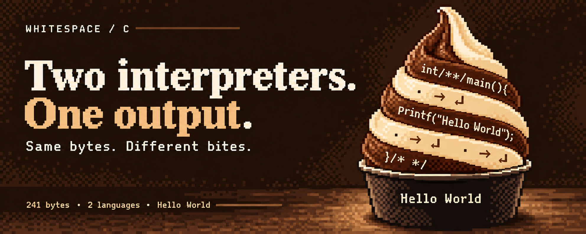

# whitespace-c-polyglot

A `Hello World` that runs two ways from one file.

- **As C**, `hello.c` compiles and prints `Hello World`.
- **As [Whitespace](https://en.wikipedia.org/wiki/Whitespace_(programming_language))**, the *whitespace bytes of that same file* — every space, tab, and newline, in order — are themselves a Whitespace program that prints `Hello World`.

```sh
# C half
gcc hello.c -o hello && ./hello        # -> Hello World

# Whitespace half (same file)
python3 ws_interp.py hello.c           # -> Hello World
```

The file is 241 bytes: 74 of C, 167 of hidden whitespace.

## How it works

Whitespace ignores every byte except space, tab, and newline, so to a Whitespace interpreter the C source is just a long comment — and the only meaningful content is the whitespace the C happens to contain. The two languages are kept from colliding by three tricks:

1. **No stray C whitespace.** The C uses empty comments `/**/` as token separators instead of spaces, e.g. `int/**/main`, so the C syntax contributes no whitespace of its own.
2. **The one forced space is load-bearing.** The space between `Hello` and `World` in the printed string is unavoidable — so it's made the *first* instruction of the Whitespace program (a `push`, which begins with a space).
3. **The rest hides in a trailing comment.** Every remaining tab and newline of the Whitespace program lives inside a final `/* ... */` block, invisible to a casual reader.

The visible skeleton is just:

```c
int/**/printf(const/**/char*,...);int/**/main(){printf("Hello World");}/* ... */
```

where `...` is the 166 remaining whitespace bytes.

## Regenerating

`generate.py` builds `hello.c` from scratch: it encodes each character of the message as a Whitespace `push` + `output-char`, maps the tokens to real whitespace bytes, and weaves them into the C scaffold. Change the `msg` variable and rerun to hide a different message:

```sh
python3 generate.py
```

## Files

- `hello.c` — the polyglot
- `generate.py` — builds `hello.c`
- `ws_interp.py` — a minimal Whitespace interpreter (push / output-char / end) used to verify the hidden half
